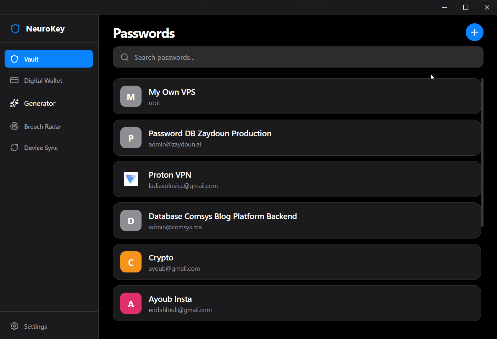

<div align="center">


# NeuroKey Desktop

**A password manager that keeps your secrets on your own devices.**

Passwords and payment cards, encrypted on your computer and synced to your phone over your own Wi-Fi.
No account server. No cloud. No subscription.

[](#-getting-started)
[](https://tauri.app/)
[](https://react.dev/)
[](https://www.typescriptlang.org/)
[](https://www.rust-lang.org/)
[](#-how-your-data-is-protected)
[](#-what-leaves-your-computer)

[Features](#-whats-inside) · [Why](#-why-neurokey) · [Security](#-how-your-data-is-protected) · [Device sync](#-device-sync-phone--desktop) · [Getting started](#-getting-started) · [Roadmap](#-roadmap)

<br />



</div>

---

## 🧠 Why NeuroKey

Most password managers ask for the same deal: hand your entire digital life
to their servers and trust that they'll never be breached, sold, or shut down.
For many people that trade is fine. NeuroKey exists for the people it isn't.

NeuroKey is the desktop half of a two-app ecosystem (desktop + Android). The
vault lives in an encrypted file on your machine, and the only way it moves to
another device is a direct, encrypted transfer across your own local network —
started by you, by scanning a QR code.

| Principle | What it means for you |
| --- | --- |
| 🔐 **Only you hold the key** | Your master password is never stored anywhere — not even on your own disk. Without it, the vault file is unreadable noise. |
| 🏠 **Your data stays home** | There is no NeuroKey server. Nothing is uploaded, backed up, or "synced to the cloud". |
| 📶 **Sync without the internet** | Phone ↔ desktop transfer happens over your Wi-Fi, encrypted with a one-time key that only exists inside the QR code. |
| 🔒 **Locks itself** | Walk away and the vault locks automatically, wiping decrypted data from memory. |
| 🪶 **Native & lightweight** | Built on Tauri (Rust) instead of Electron — small install, fast startup, low memory. |

---

## 🧰 What's Inside

<table>
<tr>
<td valign="top" width="50%">

### 🔑 Password Vault
- **Store logins** — name, username/email, password, website, notes
- **Instant search** across everything you've saved
- **Website icons** shown next to each entry
- **One-click copy** for usernames and passwords
- **Per-entry breach check** when you open a password

### 💳 Digital Wallet
- **Save payment cards** — Visa, Mastercard, Amex
- **Realistic card previews** with brand styling
- **Copy card number / CVV** in one click

### 🎲 Password Generator
- **Cryptographically secure** randomness from the OS
- Choose **length** and **character sets** (A–Z, a–z, 0–9, symbols)
- **Live strength meter**: Weak / Good / Strong

</td>
<td valign="top" width="50%">

### 📡 Breach Radar
- **Scan your whole vault** against billions of leaked passwords
- **Health score** for your vault at a glance
- Uses *k-anonymity* — your passwords are never sent ([details](#-what-leaves-your-computer))

### 🔄 Device Sync
- **QR-code pairing** with NeuroKey Mobile
- **Local Wi-Fi only** — no internet, no relay server
- **Smart merge** — the newest version of each entry wins, and deletions sync too

### ⚙️ Settings & Safety
- **Auto-lock** after 1, 5 or 15 minutes of inactivity (or never)
- **Wipe all data** — permanently destroy the vault on this device
- **Security tips** built right into the app
- **Signed in-app updates** — install new versions in one click
- **Custom frameless window** with a native feel

</td>
</tr>
</table>

---

## 🛡️ How Your Data Is Protected

> **In plain words:** your master password is turned into a key, that key locks
> your vault, and the key is thrown away the moment the vault locks. Nobody —
> including the people who wrote this app — can open your vault without your
> master password.

<details>
<summary><b>🔬 Technical details — vault format <code>nk2</code></b></summary>

<br />

The cryptography lives in [src/core/vaultCrypto.ts](src/core/vaultCrypto.ts) and
the unlock flow in [src/core/vaultAuth.ts](src/core/vaultAuth.ts).

| Layer | Implementation |
| --- | --- |
| **Key derivation** | PBKDF2-HMAC-SHA256, **600,000 iterations** (OWASP 2023 recommendation), 128-bit random salt, via native WebCrypto. Iteration count is stored per vault so it can be raised later. |
| **Key separation** | Two sub-keys from the master key: `enc = HMAC-SHA256(master, "neurokey-enc")`, `mac = HMAC-SHA256(master, "neurokey-mac")` |
| **Encryption** | AES-256-CBC, fresh random 128-bit IV for every write |
| **Integrity** | Encrypt-then-MAC with HMAC-SHA256 over `nk2.<iv>.<ciphertext>`; tag compared in constant time. Any tampering → decryption refused. |
| **Payload format** | `nk2.<iv b64>.<ciphertext b64>.<tag b64>` — byte-compatible with NeuroKey Mobile |
| **Password check** | A known value encrypted with the key acts as a verifier. The master password and the derived key are **never written to disk**. |
| **In memory** | The key and decrypted items live only in RAM while unlocked; locking (manual or auto) clears both. |
| **Randomness** | `crypto.getRandomValues` (OS CSPRNG), with rejection sampling in the generator to avoid modulo bias |
| **Storage** | A single file, `neurokey_secure.dat`, in the app's data folder (Tauri Store plugin) |
| **Legacy migration** | Vaults created by v1 (5,000 iterations, no MAC) are upgraded to `nk2` automatically on the next successful unlock. |

**What is *not* encrypted in the vault file:** the email address you signed up
with (used to show the login screen), the salt, and the KDF parameters. None of
these help an attacker open the vault.

</details>

---

## 🔄 Device Sync (Phone ↔ Desktop)

Syncing never touches the internet. Both devices must be on the same Wi-Fi.

```text
 ┌─────────────── Desktop ───────────────┐                ┌──── NeuroKey Mobile ────┐
 │ 1. Generates a one-time session id    │                │                         │
 │    + a random 256-bit key             │   QR code      │ 2. Scans the QR code    │
 │ 3. Shows them in a QR code  ──────────┼───(on screen)──┼─▶  (key never sent over │
 │                                       │                │     the network)        │
 │ 5. Checks the session id, swaps       │◀── encrypted ──┤ 4. Sends its vault,     │
 │    vaults, verifies + decrypts, merges│─── encrypted ─▶│    encrypted with key   │
 └───────────────────────────────────────┘   local Wi-Fi  └─────────────────────────┘
```

**For everyone:** the QR code is a one-time, five-minute pass. Anyone else on
your Wi-Fi only ever sees scrambled data, because the key to unscramble it was
shown on your screen — never sent across the network.

<details>
<summary><b>🔬 Technical details</b></summary>

<br />

- A small HTTP server (Rust, `axum`) listens on port **8080** of your local
  network ([src-tauri/src/main.rs](src-tauri/src/main.rs)).
- It **rejects every request** unless the Sync screen is open with a live QR code.
- Each session is **single-use** and **expires after 5 minutes**; closing the
  Sync screen cancels it immediately.
- The phone proves it scanned the QR by presenting the session id (compared in
  constant time).
- Both vaults travel encrypted + authenticated with the session key (`nk2`
  format). The Rust layer only ever handles opaque ciphertext — it never sees
  the session key or any plaintext.
- No CORS layer, on purpose: web pages open in a browser cannot talk to the
  sync server.
- Merging is last-write-wins per entry (`updated_at`). Deleted entries are
  kept as tombstones so deletions propagate between devices.

</details>

---

## 🌐 What Leaves Your Computer

Honesty over marketing: NeuroKey has no server of its own, but three features
do reach the internet. Here is exactly what they send.

| Feature | Goes to | What is sent | What is **never** sent |
| --- | --- | --- | --- |
| **Breach Radar** & per-entry breach check | `api.pwnedpasswords.com` (Have I Been Pwned) | The first **5 characters** of the password's SHA-1 hash. The check is completed locally. | Your password, or its full hash |
| **Website icons** | Google's favicon service | The **domain name** of the website you saved (e.g. `github.com`) | Usernames, passwords, notes, cards |
| **Update check** — once per launch after unlocking, or from **Settings → Check for Updates** | GitHub Releases (this repository) | A request for the latest version info (`latest.json`), plus the installer download when an update is installed. Every update is verified against NeuroKey's signing key before it's applied. | Anything from your vault |
| **Device sync** | Your phone, on your local network only | Your vault, encrypted with a one-time key | Anything readable |

Everything else — unlocking, encrypting, generating, searching, auto-lock —
happens entirely offline.

---

## 🚀 Getting Started

### Prerequisites

- [Node.js](https://nodejs.org/) (LTS)
- [Rust](https://www.rust-lang.org/tools/install) (stable)
- Tauri's Windows prerequisites — Microsoft C++ Build Tools and WebView2
  ([guide](https://tauri.app/start/prerequisites/))

### Run in development

```bash
git clone https://github.com/Ayoub-EDAHLOULI/neurokey-desktop.git
cd neurokey-desktop
npm install
npm run tauri dev
```

### Build a release binary

```bash
npm run tauri build
```

The installer and executable are written to `src-tauri/target/release/`.

### First launch

1. **Create your vault** — enter your name, email and a master password (8+ characters).
2. **Remember that password.** There is no "forgot password": it is the only key to your data.
3. Start adding passwords and cards, or open **Device Sync** to pull them from your phone.

> 💡 Windows may ask to allow NeuroKey through the firewall the first time it
> starts — that's the local sync server. Allow it on **private networks** only.

---

## 🏗️ Tech Stack

| Layer | Technology |
| --- | --- |
| Native shell | [Tauri 2](https://tauri.app/) (Rust) — window, secure storage, local sync server |
| Sync server | [axum](https://github.com/tokio-rs/axum) + [tokio](https://tokio.rs/) |
| UI | [React 19](https://react.dev/) + [TypeScript](https://www.typescriptlang.org/) + [Tailwind CSS](https://tailwindcss.com/) |
| State | [Zustand](https://zustand-demo.pmnd.rs/) |
| Animations | [Framer Motion](https://motion.dev/) |
| Crypto | WebCrypto (PBKDF2, CSPRNG) + `crypto-js` (AES, HMAC) |
| Build | [Vite](https://vite.dev/) |

### Project structure

```text
src/
├── core/
│   ├── vaultCrypto.ts   # nk2 format: key derivation, AES + HMAC, CSPRNG
│   ├── vaultAuth.ts     # create / unlock vault, v1 → nk2 migration
│   ├── encryption.ts    # persistence of the encrypted vault file
│   └── breachCheck.ts   # Have I Been Pwned k-anonymity lookup
├── store/
│   └── useVaultStore.ts # in-memory vault, encrypts on every change
├── pages/               # Vault, Wallet, Generator, Breach Radar, Sync, Settings…
└── components/          # Title bar, credit card, brand icons, alerts
src-tauri/
└── src/main.rs          # Tauri app + one-time-session local sync server
```

---

## 🗺️ Roadmap

<details>
<summary><b>Core vault</b> ✅</summary>

- [x] Master-password vault with encrypted local storage
- [x] Passwords: add, view, edit, delete, search
- [x] Digital wallet for payment cards
- [x] Secure password generator with strength meter
- [x] Auto-lock with memory wipe
- [x] Wipe all data

</details>

<details>
<summary><b>Security hardening</b> ✅</summary>

- [x] Vault format `nk2`: PBKDF2 600k + AES-256 + HMAC (encrypt-then-MAC)
- [x] Transparent migration of v1 vaults
- [x] Bias-free CSPRNG password generation
- [x] Breach Radar with k-anonymity

</details>

<details>
<summary><b>Ecosystem</b> 🚧</summary>

- [x] QR-code pairing with NeuroKey Mobile
- [x] One-time, expiring, end-to-end encrypted local sync
- [x] Smart merge with deletion tombstones
- [ ] Change master password
- [ ] Secure notes
- [ ] Encrypted export / import (backup)
- [ ] Clipboard auto-clear
- [ ] Optional offline mode (no favicons, no breach lookups, no update checks)
- [ ] Signed release builds · macOS & Linux packages

</details>

---

## 🤝 Contributing

Issues and pull requests are welcome. Two ground rules:

- **No new network calls** without a clear, user-visible reason — and an entry
  in [What Leaves Your Computer](#-what-leaves-your-computer).
- **Don't break the `nk2` format.** It must stay byte-compatible with
  NeuroKey Mobile, since each app reads the other's sync payloads.

Found a security issue? Please report it privately rather than opening a public issue.

<div align="center">
<br />
<sub>Your keys. Your devices. Your network. 🧠</sub>
</div>
